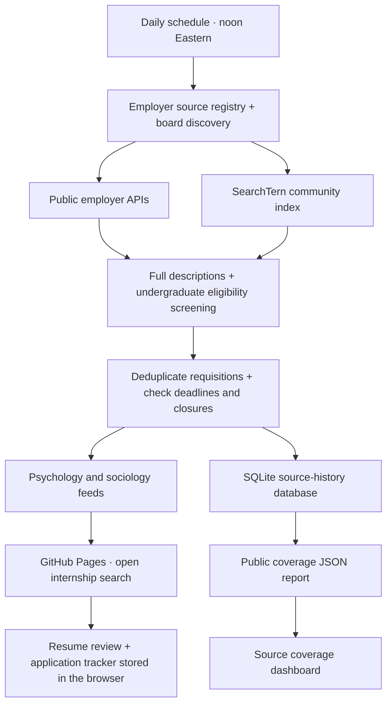

# Path49 source pipeline

The registry contains employer board identifiers, not hand-entered job listings. Each scan records source health, screened internship yield, and failures. Workday priority sources support targeted student/research searches and full internship descriptions. Jibe/iCIMS Attract career APIs are supported alongside Greenhouse, Lever, Ashby, SmartRecruiters, BambooHR and Workday.

The database preserves source-run statistics and screened job observations across refreshes. Reports distinguish working sources from productive sources and recent carryovers from failed sources. Combined totals deduplicate applications shared between psychology and sociology. Metro counts use the same matching rules as the search pages.

SQLite and report snapshots are updated in the scheduled GitHub Actions workflow, committed, and published to GitHub Pages. The site uses public JSON reads; it does not depend on a running database server. The existing optional PostgreSQL backend remains separate and requires its own configured database service. Personal resumes and application notes never enter the public source database.

Source coverage reports the collected catalogue, not the total number of internships in a city. No system can guarantee admission or qualification from a title match. The listing and resume review help students check employer requirements.
